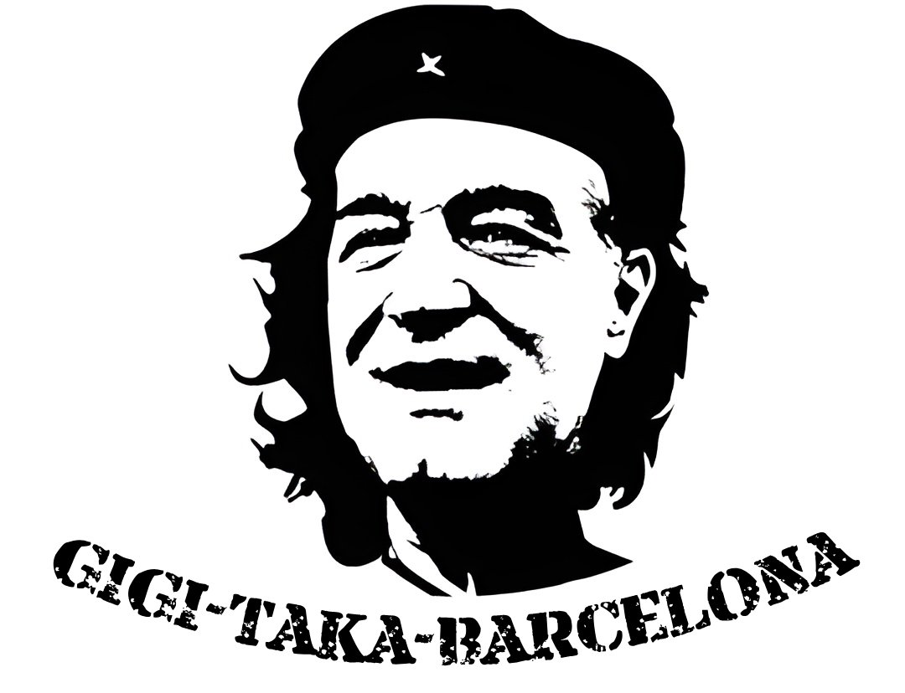
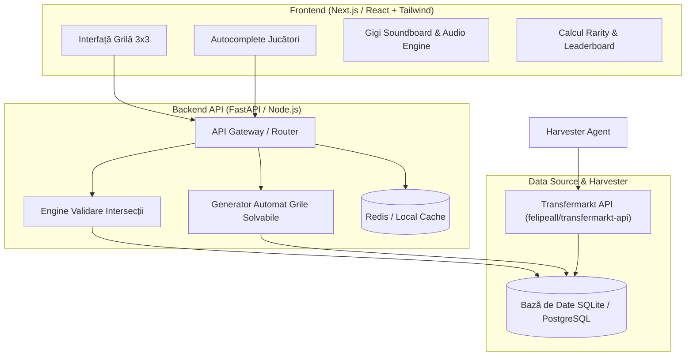

<div align="center">

# ⚽ GIGI-TAKA-BARCELONA ⚽



### *"Faci pac, pac, tiki-taka Barcelona! Nu vă supărați, cine e pe primul loc?"*

**Jocul suprem de Football Grid Trivia (Tic-Tac-Toe) dedicat fotbalului românesc și legendelor sale.**

[](https://opensource.org/licenses/MIT)
[](https://gabarsolon.github.io/gigi-taka-barcelona/)
[](https://github.com/felipeall/transfermarkt-api)
[](#)

</div>

---

## 📌 Cuprins
- [Despre Proiect](#-despre-proiect)
- [Cum se Joacă (Regulament)](#-cum-se-joacă-regulament)
- [Idei Inedite & Moduri de Joc](#-idei-inedite--moduri-de-joc)
- [Criterii & Categorii Românești](#-criterii--categorii-românești)
- [Arhitectură & Tehnologii](#-arhitectură--tehnologii)
- [Integrarea cu Transfermarkt API](#-integrarea-cu-transfermarkt-api)
- [Analiză Referință (Decompilare Tiki Taka Toe)](#-analiză-referință-decompilare-tiki-taka-toe)
- [Structura Proiectului](#-structura-proiectului)
- [Echipa de Agenți AI](#-echipa-de-agenți-ai)
- [Plan de Dezvoltare (Roadmap)](#-plan-de-dezvoltare-roadmap)

---

## 📖 Despre Proiect

**Gigi-Taka-Barcelona** este o aplicație web interactivă de tip **Football Grid Trivia** (cunoscută internațional prin *Tiki Taka Toe* sau *Footy Tic-Tac-Toe*), adaptată 100% pentru universul unic, plin de savoare, rivalități istorice și momente antologice al fotbalului românesc.

În loc să cauți doar jucători din Premier League sau La Liga, aici grila 3x3 te provoacă să găsești fotbaliști care au trecut prin **Liga 1 / Superliga României**, jucători români care au evoluat în campionatele de top ale lumii, membri ai **Generației de Aur**, transferuri de neuitat între marile rivale și fotbaliști antrenați de tehnicieni legendari.

Totul este învăluit în umorul și replicile memorabile ale patronului din Pipera: intervenții neașteptate, schimbări dictate în minutul 20 și sound effects autentice!

---

## 🎯 Cum se Joacă (Regulament)

Jocul se bazează pe o grilă **3x3** similară jocului de X și 0:

```
                  Dinamo București      FC Barcelona         Peste 50 de selecții la Națională
             ┌─────────────────────┬─────────────────────┬─────────────────────────────────────┐
             │                     │                     │                                     │
FCSB/Steaua  │   [ ex: Dănciulescu]│    [ ex: Hagi ]     │          [ ex: Pintilii ]           │
             │                     │                     │                                     │
             ├─────────────────────┼─────────────────────┼─────────────────────────────────────┤
             │                     │                     │                                     │
Rapid        │   [ ex: Lobonț ]    │    [ ex: nimeni ]   │          [ ex: Daniel Niculae ]     │
             │                     │                     │                                     │
             ├─────────────────────┼─────────────────────┼─────────────────────────────────────┤
             │                     │                     │                                     │
Serie A      │   [ ex: Mutu ]      │    [ ex: Popescu ]  │          [ ex: Chivu ]              │
             │                     │                     │                                     │
             └─────────────────────┴─────────────────────┴─────────────────────────────────────┘
```

1. **Grilă 3x3 cu condiții duble**: Fiecare celulă reprezintă intersecția dintre o **Linie** și o **Coloană** (Club x Club, Club x Naționalitate, Club x Trofeu, Club x Antrenor).
2. **Identificare Unică**: Jucătorul trebuie să introducă numele unui fotbalist (activ sau retras) care a evoluat la ambele echipe sau îndeplinește ambele criterii.
3. **Fără Repetare**: Un jucător folosit într-o celulă nu mai poate fi folosit în altă celulă din aceeași partidă.
4. **Validare pe Minute/Transferuri Oficiale**: Un jucător este valid dacă are cel puțin o apariție oficială sau contract înregistrat la ambele cluburi.
5. **Scor de Raritate (Gigi Rarity Score)**: Cu cât alegi un jucător mai obscur sau mai de nișă (ales de mai puțini utilizatori), cu atât scorul tău este mai mare!

---

## 💡 Idei Inedite & Moduri de Joc

Pentru a transforma jocul într-un fenomen viral, am conceput o serie de funcționalități și moduri dedicate:

### 1. 🎙️ Modul "Gigi Becali" (Schimbare în Minutul 20!)
- **Intervenții live**: Dacă eziți mai mult de 20 de secunde pe o căsuță, pe ecran apare Gigi cu telefonul la ureche: *"Băi băiatule, schimbați-l că doarme pe teren!"*.
- **Comentariu audio dinamic**:
  - Răspuns corect: *"Poc! Pac! Tiki-Taka Barcelona! Spulberăm tot!"*, *"Bravo tată, meriți clauză de 50 de milioane!"*
  - Răspuns greșit: *"Băi băiatule, ești nebun? La revedere, transfer pe bancă!"*, *"M-am certat cu fotbalul!"*
  - Răspuns ultra-rar: *"Ai văzut ce jucător am descoperit eu? Un diamant!"*
- **"Veto de Patron"**: Ocazional, Gigi refuză un jucător pe motive subiective: *"Ăsta nu se potrivește la stilul nostru, mai caută!"*

### 2. ⚔️ Duel 1v1 PvP ("Derby de România")
- **Multiplayer în timp real**: Joacă împotriva unui prieten pe aceeași grilă.
- Obiectivul clasic de X și 0: Primul care completează 3 căsuțe pe o linie, coloană sau diagonală câștigă meciul.
- Opțiune de furt de celulă dacă adversarul a greșit răspunsul!

### 3. 📅 Provocarea Zilei (Daily Gigi Grid)
- O grilă nouă generată în fiecare zi la miezul nopții.
- Toți jucătorii din România joacă aceeași grilă.
- Clasament național bazat pe **Gigi Score** (acuratețe + raritate a jucătorilor).
- Distribuire rezultate pe WhatsApp/Social Media în format emoji (grilă verde/roșie stil Wordle/Tiki Taka Toe).

### 4. 🕰️ Nostalgia Liga 1 (Epoca de Aur & Campionatul Anilor 2000-2010)
- Mod tematic cu echipe istorice care nu mai sunt în prim-plan sau care au scris istorie:
  - **FC Vaslui** (era Porumboiu), **Unirea Urziceni** (Dan Petrescu), **Oțelul Galați** (Dorinel Munteanu), **Gloria Bistrița** (Jean Pădureanu), **Poli Timișoara** (Marian Iancu), **Astra Giurgiu**.

### 5. ⚡ Solo Blitz & Survival
- Răspunde la cât mai multe intersecții contra-cronometru.
- Ai 3 vieți; la fiecare răspuns greșit primești un "cartonaș galben", la al doilea ești eliminat!

---

## 🇷🇴 Criterii & Categorii Românești

Grilele pot combina următoarele tipuri de condiții:

| Categorie | Exemple de criterii |
|---|---|
| **Cluburi Tradiționale** | FCSB / Steaua, Dinamo, Rapid, Universitatea Craiova, CFR Cluj, Farul Constanța, Petrolul Ploiești, UTA Arad |
| **Cluburi Străine Frecvente** | FC Barcelona, Real Madrid, Inter Milano, Galatasaray, Ajax, Fiorentina, Parma, Shakhtar Donetsk, Standard Liège |
| **Rivalități Directe ("Trădătorii")** | A jucat și la Steaua/FCSB și la Dinamo; A jucat și la Rapid și la Dinamo |
| **Antrenori Legendați** | A jucat sub comanda lui Mircea Lucescu, Dan Petrescu, Victor Pițurcă, Laurențiu Reghecampf, Gică Hagi |
| **Trofee & Palmares** | Campion al României, Câștigător Cupa României, A jucat în Champions League, Campion în străinătate |
| **Echipa Națională** | Prezență la World Cup (1990/1994/1998), Prezență la EURO (2000/2008/2016/2024), Peste 25 de selecții |
| **Statistici Speciale** | Golgheter al Ligii 1, Gol marcat într-un Derby de România, Transferat pe o sumă de peste 3 mil. € |

---

## 🏗️ Arhitectură & Tehnologii

Proiectul este gândit ca o aplicație web modernă, rapidă și complet responsivă:



### Stiva Tehnică Recomandată:
- **Frontend**: Next.js 14+ (App Router), TypeScript, Tailwind CSS, Framer Motion (pentru animații fluente de meci), Howler.js (pentru replicile audio).
- **Backend**: FastAPI (Python) sau Next.js API Routes / Express.
- **Bază de date**: PostgreSQL / SQLite cu pre-indexare a transferurilor pentru căutare fulgerătoare (< 30ms).
- **Sursă date**: [felipeall/transfermarkt-api](https://github.com/felipeall/transfermarkt-api) pentru extragerea profilurilor, istoricului de transferuri și statisticilor de pe Transfermarkt.

---

## 📡 Integrarea cu Transfermarkt API

Folosim proiectul open-source [felipeall/transfermarkt-api](https://github.com/felipeall/transfermarkt-api) pentru a obține date exacte și actualizate:

1. **Căutare & Autocomplete Jucător**:
   - `GET /players/search/{player_name}`: Oferă lista de sugestii cu poză, echipă curentă și naționalitate în timp ce utilizatorul tastează.
2. **Istoricul Transferurilor (Inima Validării)**:
   - `GET /players/{player_id}/transfers`: Returnează toate cluburile prin care a trecut fotbalistul de-a lungul carierei (inclusiv împrumuturi, echipe de tineret, transferuri definitive).
3. **Profil & Criterii Extra**:
   - `GET /players/{player_id}/profile`: Naționalitate, post în teren, picior preferat, înălțime, meciuri internaționale.
4. **Palmares & Trofee**:
   - `GET /players/{player_id}/achievements`: Titluri de campion, cupe naționale, trofee europene.
5. **Cariera la Națională**:
   - `GET /players/{player_id}/national_career`: Meciuri și goluri pentru România (Seniori, U21, U19).

---

## 🔍 Analiză Referință (Decompilare Tiki Taka Toe)

Aplicația originală de referință (`Tiki+Taka+Toe_1.1.47_APKPure.xapk`) a fost decompilată cu succes folosind **JADX** cu 32 de threaduri și deobfuscare:

* **Pachet Android**: `com.playfootballgames.tikitakatoe`
* **Arhitectură tehnică**: Aplicație cross-platform construită pe **React Native** cu motor **Hermes Bytecode** (`index.android.bundle`).
* **Locație fișiere decompilate**: `C:\Users\remus\Downloads\TikiTakaToe_decompiled\`
* **Observații cheie din decompilare**:
  - Grilele folosesc o structură de tip matrice de validare bazată pe `club_id` și `player_id`.
  - Sistemul de sugestii (autocomplete) este decuplat de motorul de validare pentru a reduce latența la tastare.
  - Scorarea se face la final prin compararea alegerii locale cu un vector agregat de selecții la nivel global (pentru a calcula procentajul de raritate).

---

## 📂 Structura Proiectului

```
gigi-taka-barcelona/
├── assets/
│   └── gigi-taka-barcelona.jpg    # Logo & identitate vizuală
├── docs/
│   └── game-rules.md              # Detalii regulament și cazuri particulare
├── agents.md                      # Ghidul și definiția agenților AI
├── README.md                      # Documentația principală a proiectului
└── (codul sursă web / api / scraper)
```

---

## 🤖 Echipa de Agenți AI

Proiectul este orchestrat folosind o echipă dedicată de agenți inteligenți, documentată în detaliu în [agents.md](agents.md):

1. **Scout & Harvester Agent**: Răspunde de interogarea și sincronizarea datelor din Transfermarkt API.
2. **Grid Architect Agent**: Construiește grile 3x3 echilibrate, verificând matematic că fiecare căsuță are cel puțin o soluție validă.
3. **Referee & Verification Agent**: Verifică răspunsurile jucătorilor și tranșează cazurile ambigue (ex: FCSB vs Steaua, echipe desființate).
4. **Commentator & Banter Agent ("Vocea Patronului")**: Asigură replicile audio, umorul și atmosfera specifică Gigi Becali.
5. **Frontend Architect Agent**: Implementează componentele de UI/UX, animațiile și sistemul de joc web.

---

## 🚀 Plan de Dezvoltare (Roadmap)

- [x] **Faza 1**: Analiză cerințe, decompilare aplicație referință și definire concept vizual.
- [x] **Faza 2**: Documentare arhitectură completă, README și ghid agenți AI (`agents.md`).
- [ ] **Faza 3**: Prototipare script de sincronizare date cu `felipeall/transfermarkt-api` pentru cluburile din România și jucătorii români.
- [ ] **Faza 4**: Construire motor de joc (Grid Generator + Validator) cu baza de date locală.
- [ ] **Faza 5**: Dezvoltare interfață web responsivă (Next.js + Tailwind) cu soundboard Gigi Becali.
- [ ] **Faza 6**: Modul 1v1 PvP și clasamentul zilnic cu Rarity Score.

---

<div align="center">
  <sub>Proiect realizat cu pasiune pentru fotbalul românesc și umorul inconfundabil al Ligii 1.</sub>
</div>
