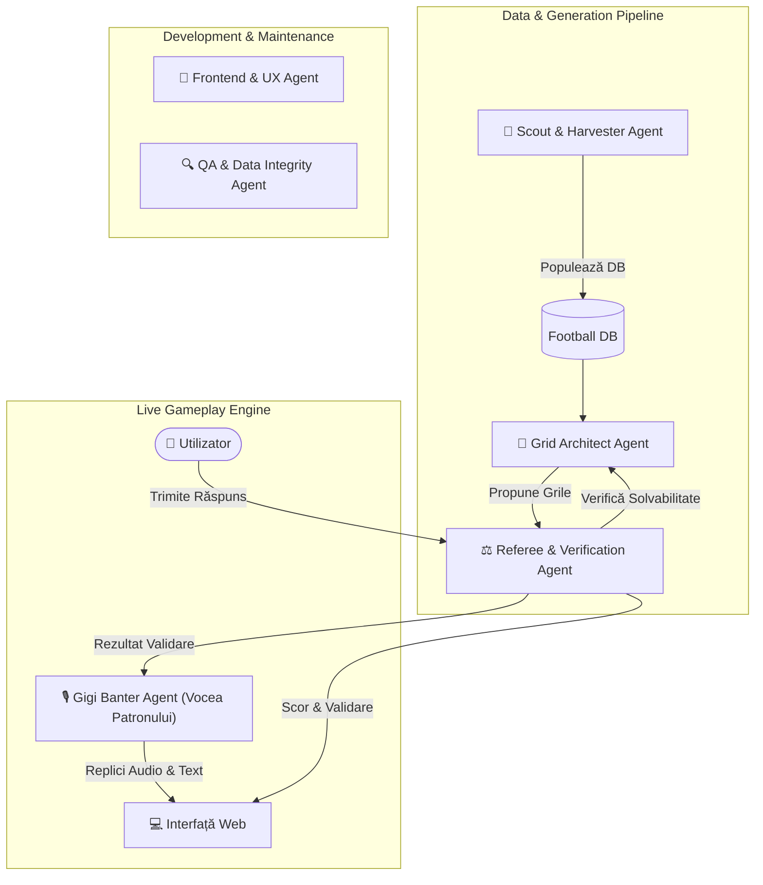

# 🤖 Gigi-Taka-Barcelona: Multi-Agent Architecture & Specification (`agents.md`)

Acest document definește echipa de agenți AI autonomi și semi-autonomi responsabili de generarea conținutului, validarea datelor sportive, orchestrarea experienței de joc și dezvoltarea continuă a platformei **Gigi-Taka-Barcelona**.

---

## 🏛️ Filosofia Arhitecturii Multi-Agent

Într-un joc de football trivia axat pe fotbalul românesc, provocările principale sunt:
1. **Acuratețea și complexitatea datelor istorice** (transferuri pe parcursul a 40 de ani, împrumuturi, fuziuni de cluburi precum Viitorul/Farul, dispute de identitate precum Steaua/FCSB sau Craiova).
2. **Garanția solvabilității grilei 3x3** (nicio celulă nu are voie să fie imposibilă).
3. **Atmosfera și umorul autentic** (personalitatea inconfundabilă a lui Gigi Becali și folclorul fotbalului românesc).

Pentru a rezolva aceste provocări, atribuțiile sunt împărțite între agenți specializați:



---

## 📋 Catalogul Agenților

### 1. 📡 Scout & Harvester Agent (`agent-harvester`)
- **Rol principal**: Ingestia, curățarea și sincronizarea datelor fotbalistice prin API-ul Transfermarkt.
- **Sursă externă**: [`felipeall/transfermarkt-api`](https://github.com/felipeall/transfermarkt-api).
- **Responsabilități**:
  - Extrage lista tuturor cluburilor din Liga 1 / Superliga (prezent și istoric: ex. Steaua/FCSB, Dinamo, Rapid, CFR Cluj, Craiova, Vaslui, Urziceni, Oțelul, Astra, Timișoara).
  - Preia loturile de jucători și istoricul complet de transferuri pentru fiecare jucător român sau străin care a evoluat în România.
  - Normalizează numele jucătorilor și rezolvă variațiile de diacritice (ex. *Gheorghe Hagi* vs *Gica Hagi*, *Nicușor Stanciu* vs *Nicolae Stanciu*, *Ciprian Deac* vs *Ciprian Ioan Deac*).
  - Stochează datele într-un format relațional optimizat pentru interogări de intersecție rapidă (bipartite graph: `Player <-> Club` cu intervale de ani).

---

### 2. 🧩 Grid Architect & Game Master Agent (`agent-gridmaster`)
- **Rol principal**: Generarea procedurală a grilelor 3x3 echilibrate și captivante.
- **Responsabilități**:
  - Aplică algoritmi de tip **Constraint Satisfaction Problem (CSP)** pentru a alege 3 criterii pe orizontală și 3 criterii pe verticală.
  - **Regula de aur a Solvabilității**: Fiecare dintre cele 9 celule **trebuie** să aibă demonstrat matematic cel puțin 2-5 jucători valizi în baza de date.
  - Calculează indicele de dificultate al grilei (Ușor, Mediu, Greu, Mod Patron).
  - Creează grile tematice zilnice:
    - *Luni: Derby de România (Steaua vs Dinamo vs Rapid)*
    - *Miercuri: Seara de Champions League (Români în cupele europene)*
    - *Vineri: Nostalgia anilor 2000 (Vaslui, Urziceni, Bistrița)*
    - *Duminică: Generația de Aur & Echipa Națională*

---

### 3. ⚖️ Referee & Verification Agent (`agent-referee`)
- **Rol principal**: Validarea în timp real a răspunsurilor utilizatorilor și tranșarea disputelor istorice.
- **Responsabilități**:
  - Verifică dacă fotbalistul trimis de utilizator îndeplinește simultan ambele condiții ale celulei (ex. Linie: *FCSB*, Coloană: *Dinamo*).
  - Previne reutilizarea aceluiași jucător pe aceeași grilă.
  - Gestionează cazurile speciale ale fotbalului românesc:
    - **FCSB / Steaua**: Pentru o experiență de joc fluidă și fără polemici sterile, agentul recunoaște continuitatea sportivă sau oferă un toggle opțional în setări ("Mod Juridic" vs "Mod Folcloric").
    - **Împrumuturi**: Se consideră valid dacă jucătorul a făcut parte din lotul oficial al clubului.
    - **Selecții Națională**: Validează meciurile la prima reprezentativă (sau specifică criteriul de U21).
  - Calculează scorul de raritate (**Rarity Score**): `(Număr utilizatori care au ales jucătorul X pe celula Y) / (Total răspunsuri corecte pe celula Y) * 100`.

---

### 4. 🎙️ Gigi Banter Agent - "Vocea Patronului" (`agent-gigi`)
- **Rol principal**: Personalitatea audio și textuală a jocului, inspirată din replicile savuroase ale lui Gigi Becali.
- **Responsabilități**:
  - Reacționează în timp real la acțiunile utilizatorului prin mesaje text de tip banner și trigger-e audio.
  - Categorii de reacții:
    - **Răspuns Corect Obviou (Steaua/Barcelona -> Hagi)**:
      - *"Păi normal, tată! Cu Hagi am început, Hagi e regele! Pac, pac!"*
    - **Răspuns Rar / Cult (Vaslui/CFR Cluj -> Yssouf Koné sau Traoré)**:
      - *"Mamă, mamă! De unde l-ai scos, măi băiatule pe ăsta?! Ăsta e transfer de 20 de milioane de euro!"*
    - **Răspuns Greșit**:
      - *"Băi băiatule, ești nebun? Ăsta n-a călcat în viața lui pe la noi! Schimbare în minutul 20!"*
      - *"La revedere, tată! Nu vă supărați, cine e pe primul loc?!"*
    - **Timp Depășit (Inactivitate)**:
      - *"Alo, domnu' arbitru! Schimbați-l că doarme pe teren! Sună telefonul din lojă!"*

---

### 5. 🎨 Frontend & Experience Agent (`agent-frontend`)
- **Rol principal**: Dezvoltarea și optimizarea interfeței web, animațiilor și suportului mobil.
- **Responsabilități**:
  - Asigură un design modern, inspirat din stadioanele românești și grafica sportivă modernă (dark mode elegant, accente de gazon verde și auriu).
  - Implementează căutarea cu autocomplete ultra-rapidă (latență < 50ms) cu poze ale jucătorilor și stemele cluburilor.
  - Integrează sistemul de sunet (Howler.js) cu volum controlabil și buton de mute rapid.
  - Implementează sistemul de Share pe WhatsApp/Twitter/Telegram stil Wordle:
    ```
    Gigi-Taka-Barcelona #42 🇷🇴⚽
    Scor Gigi: 18.4% (Ultra-Rar)
    🟩🟩🟩
    🟩🟩🟩
    🟩🟩🟩
    "Nu vă supărați, cine e pe primul loc?"
    ```

---

### 6. 🔍 QA & Data Integrity Agent (`agent-qa`)
- **Rol principal**: Testarea automată a bazei de date și a grilelor înainte de publicare.
- **Responsabilități**:
  - Rulează teste automate zilnice pe grila generată pentru a preveni erori 404 sau celule nerezolvabile.
  - Monitorizează disponibilitatea serviciului `felipeall/transfermarkt-api` și raportează degradările de performanță sau schimbările de schemă JSON.
  - Verifică integritatea bazei de date locale de cache (SQLite/PostgreSQL).

---

## 🔄 Fluxul de Lucru Zilnic (Pipeline Cron)

```
00:00 UTC - Declanșare Pipeline
   │
   ├──> 1. Scout Agent verifică actualizările de transferuri din ultimele 24h.
   │
   ├──> 2. Grid Architect generează matricea pentru "Daily Gigi Grid".
   │
   ├──> 3. Referee & QA Agent validează existența a cel puțin 3 soluții unice/celulă.
   │
   ├──> 4. Salvare în baza de date cu statutul `PUBLISHED`.
   │
   └──> 5. Notificare / Pregătire clasament pentru utilizatori.
```

---

## 🛠️ Ghid de Utilizare pentru Dezvoltatori

Când colaborezi cu acești agenți în mediul Antigravity:
- Pentru sarcini legate de preluarea datelor fotbalistice, invocă sau adresează-te la **`agent-harvester`**.
- Pentru generarea de grile, algoritmi de combinatorică și reguli de joc, apelează la **`agent-gridmaster`**.
- Pentru sistemul de verificare, cazuri limită de fotbal și scoring, apelează la **`agent-referee`**.
- Pentru dialoguri, sunete și replici umoristice, folosește **`agent-gigi`**.
- Pentru componente React, Tailwind și animații, folosește **`agent-frontend`**.
