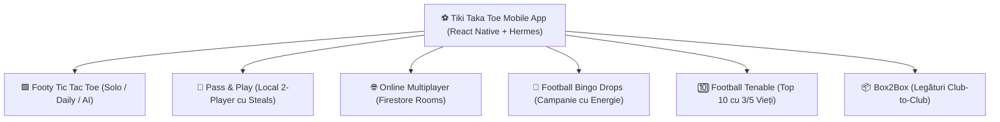
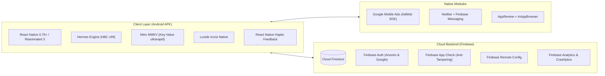
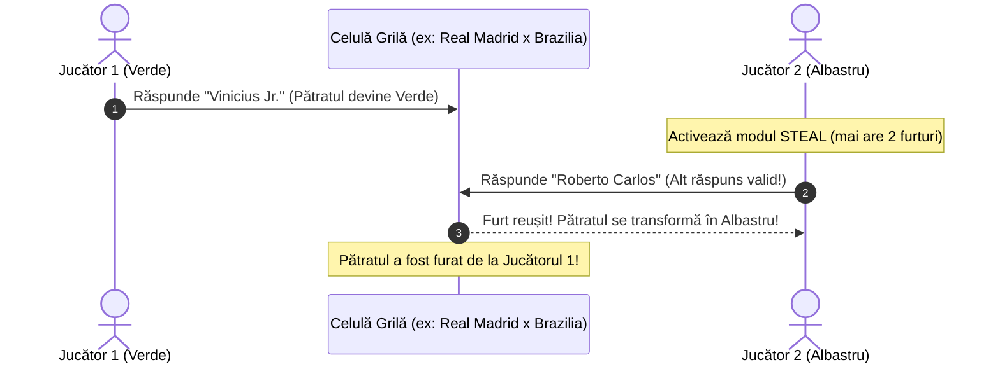

# 📱 Tiki Taka Toe: Arhitectură, Reverse Engineering & Specificație Completă (`docs/tiki-taka-toe.md`)

Acest document reprezintă analiza tehnică exhaustivă și disecția funcțională completă a aplicației mobile **Tiki Taka Toe** (produsă de studioul `PlayFootball.Games`, identificator pachet Android: `com.playfootballgames.tikitakatoe`, versiunea analizată: `1.1.47` build 136).

Documentul a fost generat prin inginerie inversă pe bytecode-ul nativ Hermes (`index.android.bundle`), resursele XML Android, fișierele DEX decompilate cu JADX și tabelele de stringuri extrase direct din memorie (93.133 de simboluri decodificate).

---

## 📑 Cuprins
1. [Rezumat Executiv & Prezentare Generală](#1-rezumat-executiv--prezentare-generală)
2. [Stack Tehnologic & Arhitectură Nativă](#2-stack-tehnologic--arhitectură-nativă)
3. [Baza de Date a Jucătorilor & Motorul de Căutare](#3-baza-de-date-a-jucătorilor--motorul-de-căutare)
4. [Cele 5 Moduri de Joc Principale](#4-cele-5-moduri-de-joc-principale)
   - [4.1 Footy Tic Tac Toe (Grila Clasică 3x3 Solo & vs AI)](#41-footy-tic-tac-toe-grila-clasică-3x3-solo--vs-ai)
   - [4.2 Pass & Play (Duel Local 1v1 pe același dispozitiv)](#42-pass--play-duel-local-1v1-pe-același-dispozitiv)
   - [4.3 Mecanica Semnătură: Sistemul de Furt ("Steals Mode")](#43-mecanica-semnătură-sistemul-de-furt-steals-mode)
   - [4.4 Online Multiplayer & Camere Private](#44-online-multiplayer--camere-private)
   - [4.5 Football Bingo & Bingo Drops (Modul Progresiv cu Energie)](#45-football-bingo--bingo-drops-modul-progresiv-cu-energie)
   - [4.6 Football Tenable / Tenaball (Quiz Top 10 cu Vieți)](#46-football-tenable--tenaball-quiz-top-10-cu-vieți)
   - [4.7 Box2Box (Tranziții & Legături)](#47-box2box-tranziții--legături)
5. [Taxonomia Criteriilor & Categoriilor de Fotbal](#5-taxonomia-criteriilor--categoriilor-de-fotbal)
6. [Regulamentul Oficial & Validarea Datelor](#6-regulamentul-oficial--validarea-datelor)
7. [Sistemul de Scor, Raritati & Statistici](#7-sistemul-de-scor-raritati--statistici)
8. [Economie, Monetizare & Reclame (AdMob & Energie)](#8-economie-monetizare--reclame-admob--energie)
9. [Maparea Ecranelor, Navigării & Componentelor UI](#9-maparea-ecranelor-navigării--componentelor-ui)
10. [Recomandări & Adaptări Strategice pentru Gigi-Taka-Barcelona](#10-recomandări--adaptări-strategice-pentru-gigi-taka-barcelona)

---

## 1. Rezumat Executiv & Prezentare Generală

**Tiki Taka Toe** nu este doar o adaptare statică a grilei 3x3 de fotbal (tip *Immaculate Grid*), ci o platformă completă de trivia sportiv axată pe gamification competitiv, dueluri în timp real și retenție zilnică prin sezoane/drop-uri.

Dezvoltată de rețeaua britanică **PlayFootball Games** (care administrează și site-ul `https://playfootball.games`), aplicația include 5 motoare de joc distincte, un sistem de matchmaking cu coduri de cameră, o suită de inteligență artificială offline și o bază masivă de date cu **46.583 de fotbaliști profesioniști** stocată direct pe dispozitivul clientului pentru latență zero.

---

## 2. Stack Tehnologic & Arhitectură Nativă

Analiza fișierelor `MainApplication.java`, `PackageList.java`, `AndroidManifest.xml` și a containerului Hermes bytecode relevă o infrastructură modernă, de nivel enterprise:

### Module Native Identificate în `PackageList.java`:
1. **Hermes Bytecode v99 (`0x1F1903C103BC1FC6`)**:
   - Codul JS este compilat Ahead-Of-Time (AOT) în format binar Hermes.
   - Tabel de stringuri compact cu 93.133 de intrări și un storage de 1.591.014 octeți.
2. **Nitro MMKV (`com.margelo.nitro.mmkv`)**:
   - Înlocuiește lentul `AsyncStorage` cu stocare pe memorie mapată binară (MMKV C++ de la Tencent), permițând salvarea instantanee a jocurilor offline, a stării de energie și a istoricului fără lag de I/O.
3. **Software Mansion Suite**:
   - `react-native-reanimated` & `react-native-worklets` pentru animații la 60/120 FPS pe UI Thread (rotații de carduri, flip de celule, bare de progres animate).
   - `react-native-gesture-handler` & `react-native-screens` pentru navigare nativă fluidă.
   - `@gorhom/bottom-sheet` pentru sertare interactive (cum ar fi How-To, Reveal Players, Search Modal).
4. **Firebase App Check (`ReactNativeFirebaseAppCheckPackage`)**:
   - Blochează apelurile API neautorizate către bazele de date Firestore, prevenind scripturile de crawling sau trișorii din clasamente.
5. **Sistem Haptic Integrat**:
   - Feedback tactil prin vibrații diferențiate: `impactMedium` la selecție, `notificationSuccess` la gol/răspuns corect, `notificationError` la răspuns greșit.

---

## 3. Baza de Date a Jucătorilor & Motorul de Căutare

### 🗄️ Baza de Date Locală (Offline First)
Una dintre cele mai impresionante decizii de arhitectură descoperite în APK este pre-compilarea bazei de date a jucătorilor:
- **Peste 46.500 de fotbaliști profesioniști** sunt compilați direct în string pool-ul pachetului binar Hermes.
- Baza conține de la legende mondiale (Pelé, Maradona, Cruyff, Messi, Ronaldo) și staruri actuale până la jucători istorici din România (`Gabi Balint`, `Razvan Sava`, etc.), America de Sud, Asia și ligi secundare.
- **De ce această abordare?** Elimină orice dependență de server în timpul căutării. Jucătorul poate tasta cu viteză maximă chiar și pe conexiuni slabe sau offline în avion.

### 🔍 Motorul de Căutare Fuzzy
- Aplicația folosește algoritmul **Bitap Search** (implementat prin librăria `Fuse.js` integrată în bundle: `BitapSearch`, `ExtendedSearch`).
- Căutarea tolerează erori de tastare, accente omise și inversarea prenumelui cu numele de familie.
- Rezultatele se afișează în mai puțin de 5 milisecunde.

---

## 4. Cele 5 Moduri de Joc Principale

### 4.1 Footy Tic Tac Toe (Grila Clasică 3x3 Solo & vs AI)
- **Concept**: O matrice 3x3 cu 3 criterii orizontale și 3 verticale.
- **Diferență fundamentală față de Immaculate Grid**:
  - În *Immaculate Grid*, jucătorul încearcă să umple toate cele 9 celule completând puzzle-ul.
  - În *Footy Tic Tac Toe*, mecanica este cea de **X și 0**:
    - Greșești un răspuns? **Pierzi tura!** (`"Get it wrong and you lose your turn"`).
    - Câștigă primul care leagă 3 căsuțe pe linie, coloană sau diagonală (`checkForWinner`).
    - În modul Solo/Daily: scopul este realizarea unui **"Perfect Game"** (9 din 9 căsuțe corecte fără nicio greșeală).
- **Modul împotriva Inteligenței Artificiale (AI Game)**:
  - Componente: `AILanding`, `AIGame`.
  - Nivele de dificultate AI configurabile (`AI difficulty`).
  - AI-ul are o rată calculată de succes bazată pe dificultate și poate chiar să sară peste tură dacă nu găsește soluție (`"AI skipped it's turn"`).

---

### 4.2 Pass & Play (Duel Local 1v1 pe același dispozitiv)
- Componente: `PassAndPlayLanding`, `PassAndPlayGame`.
- **Experiență "Canapea / Pub"**: Doi prieteni joacă pe același telefon ecran în ecran.
- Jucătorul 1 este `X` (culoare verde), Jucătorul 2 este `O` (culoare albastră/galbenă).
- Scor pe sesiune (`scoreX`, `scoreO`).
- Funcții de meci oficial:
  - Opțiune de solicitare egalitate (`REQUEST DRAW`, `DRAW REQUESTED`, `END AS DRAW`, `"It was a bore draw!"`).
  - Posibilitate de revanșă rapidă (`Continue Rematch`, `handleStartRematch`).

---

### 4.3 Mecanica Semnătură: Sistemul de Furt ("Steals Mode")

Aceasta este inovația majoră a jocului *Tiki Taka Toe* față de orice alt joc de trivia fotbalistic:

- **Reguli Steals**:
  - Fiecare jucător are dreptul la exact **3 furturi pe meci** (`"Three steals per game"`).
  - Dacă adversarul a ocupat o căsuță, o poți viza cu Steal activat (`stealsEnabled`, `stealMode`, `toggleSteals`).
  - Trebuie să introduci un **alt jucător valid** care bifează ambele criterii ale căsuței respective.
  - Odată epuizate cele 3 încercări: `"Sorry, you have used all of your steals"`.

---

### 4.4 Online Multiplayer & Camere Private
- Conectivitate prin Firebase Firestore (`/footy-tic-tac-toe/room/`).
- **Matchmaking & Camere cu Cod**:
  - Utilizatorii pot genera un link/cod de cameră partajabil pe WhatsApp, Discord sau SMS.
  - Cross-platform: utilizatorii de Android pot juca direct împotriva utilizatorilor de pe web (`https://playfootball.games`).
- **Controlul Timpului**:
  - Suport pentru cronometru pe tură (`CountdownCircleTimer`, `useCountdown`).
  - Setări: 15 secunde/tură, 30 secunde/tură sau mod relaxat (`No Timer`).
  - Detectare automată a deconectării și abandonului de meci.

---

### 4.5 Football Bingo & Bingo Drops (Modul Progresiv cu Energie)
- Componente: `BingoLanding`, `BingoGame`, `BingoBoard`.
- **Cum se joacă**:
  - Pe ecran apare un panou tip Bingo cu diverse categorii (cluburi, națiuni, trofee).
  - Jocul îți oferă succesiv cartonașe cu jucători cunoscuți sau rari.
  - Jucătorul trebuie să apese rapid căsuța din Bingo pe care o îndeplinește acel jucător (`"A player appears, tap a category they fit"`).
  - Atenție: unii jucători sunt capcane! (`"Some players don't fit any category!"`).
  - Există un mecanism **Wildcard** (`wildcardInfoContainer`) pentru deblocarea situațiilor dificile.
  - Obiectiv: Completarea grilei cu cel mai mic număr posibil de ture (`"Complete the Bingo card in the least turns"`).
- **Algoritmul de Eficiență**:
  - Calculează un scor procentual: `calculateFootballBingoEfficiencyScore` și `averageEfficiencyScore`.
- **Economia de Energie (`bingo_energy`)**:
  - Fiecare încercare de drop consumă puncte de energie (`[handleDropBingoGameStart] Energy:`).
  - Energia se reface automat la miezul nopții (`[EnergyContext] Midnight reached, resetting energy`).
  - Jucătorii rămași fără energie pot viziona reclame video recompensate (`EnergyModal`) pentru a continua.

---

### 4.6 Football Tenable / Tenaball (Quiz Top 10 cu Vieți)
- Componente: `TenaballLanding`, `TenaballGame`.
- **Format**: Inspirat din faimosul show britanic TV "Tenable".
- Ți se dă o temă statistică de elită (ex: *"Top 10 Golgheteri All-Time Champions League"*, *"Top 10 Cei mai scumpi fundași din istorie"*, *"Top 10 Selecții în Naționala Angliei"*).
- **Sistemul de Vieți**:
  - Mod Normal: 3 vieți (`"3 lives. A wrong guess costs one. Run out and you can keep playing, answers kept"`).
  - Mod Hardcore: 5 vieți fără reluare (`"5 lives and no retries. Lose them all and the game’s over"`).
- Pachete de întrebări tematice distribuite din Cloud sub formă de **Drops** (`[Firebase] Fetching Tenaball questions for drop:`).

---

### 4.7 Box2Box (Tranziții & Legături)
- Componente: `Box2BoxLanding`, `Box2BoxGame`, `Box2BoxHowToContent`.
- Mod puzzle concentrat pe traseele de carieră: găsirea jucătorilor "punte" care conectează două echipe rivale sau din campionate diferite (de unde și numele englezesc de mijlocaș *Box-to-Box*).

---

## 5. Taxonomia Criteriilor & Categoriilor de Fotbal

Din extragerea stringurilor din aplicație reiese un arbore enciclopedic de criterii:

### 🏆 Trofee & Distincții Majore
- `Ballon d'Or` (Câștigător Balonul de Aur).
- `2+ Champions League / European Cup Titles` (Multiple Ligi ale Campionilor).
- `3+ Champions League / European Cup Titles`.
- `Champions League / European Cup Finals Appearance` (A jucat cel puțin o finală UCL).
- `Champions League / European Cup Finals Goal` (A marcat într-o finală UCL).
- `Champions League Or European Cup Golden Boot` (Golgheter UCL).
- `World Cup Final Appearance` & `World Cup Finals Goal`.
- `World Cup Golden Boot` & `World Cup Top Scorer`.
- `Treble Winner` (Campionat, Cupă și Ligă a Campionilor în același sezon).
- Duble Naționale: `English Double Winner`, `Spanish Double Winner`, `Italian Double Winner`.

### 🌍 Ligi & Campionate Internaționale
- **Top 5 Campionate Europene**: `Premier League`, `LaLiga`, `Serie A`, `Bundesliga`, `Ligue 1`.
- **Criterii Trans-Campionat**:
  - `Played in 3 of the 5 Big Leagues` (A evoluat în cel puțin 3 din cele 5 mari ligi).
  - `Played in 4 of the 5 Big Leagues`.
  - `Titles in 2 of the Big 5 Leagues` (Campion în cel puțin 2 din marile ligi).
- **Alte Ligi Licențiate în Joc**:
  - `Süper Lig` (Turcia), `Eredivisie` (Olanda), `Liga Portugal`, `Brasileirão` (Brazilia), `Liga Profesional` (Argentina), `Saudi Pro League`, `Scottish Premiership`, `Belgian Pro League`, `Greek / Cypriot League`, `Major League Soccer (USA)`.

### 👔 Manageri & Coechipieri (Teammates & Managers)
- Modul dedicat `MANAGERS`: căutare după antrenorul sub comanda căruia a jucat (ex: Guardiola, Mourinho, Klopp, Ancelotti, Ferguson).
- Modul dedicat `TEAMMATES`: jucători care au împărțit vestiarul cu un anumit superstar (ex: "A fost coechipier cu Messi" sau "cu Cristiano Ronaldo").

### 📅 Decenii & Vârste
- `Players born in the 1970s`
- `Players born in the 1980s`
- `Players born in the 1990s`
- `Players born in the 2000s`

### 🚩 Confederații & Geografie
- `UEFA`, `CONMEBOL`, `CONCACAF`, `CAF` (Africa), `AFC` (Asia/Oceania), `Celtic Nations`.

---

## 6. Regulamentul Oficial & Validarea Datelor

Aplicația include un set strict de reguli oficiale explicate în secțiunea How-To:

1. **Regula Echipei Mari (Fără Academii)**:
   > *"Team categories only include players who’ve made the first team. Being in the academy doesn’t qualify."*
   - Un jucător este valid pentru un club **doar dacă a bifat cel puțin o selecție/apariție la prima echipă**. Stagiul la grupele de juniori, academie sau echipa a doua nu este considerat.
2. **Regula Naționalității Sportive (Senior Cap Precedence)**:
   > *"A player’s classification by nation or region is based on the senior team(s) they represented. If uncapped, it follows their declared allegiance, or if none, their birthplace."*
   - Ierarhie de decizie:
     1. Naționala de seniori pentru care a debutat oficial (FIFA cap).
     2. Dacă nu are selecție la seniori: cetățenia/apartenența sportivă declarată oficial la nivel de tineret.
     3. Dacă nu există: țara natală (locul nașterii).

---

## 7. Sistemul de Scor, Raritati & Statistici

### 💎 Scorul de Raritate (Rarity Score)
- Calculează procentul comunitar: dacă pe celula *Real Madrid x Inter Milan* 80% din utilizatori l-au pus pe *Ronaldo Nazário*, scorul său este de 80% (comun). Dacă ai ales un jucător precum *Wesley Sneijder* sau *Achraf Hakimi*, scorul este mult mai mic (rar).
- **Scorul Ideal**: Cât mai aproape de 0%.

### 📊 Panoul de Statistici al Jucătorului
- `Perfect Games`: Numărul total de grile 9/9 rezolvate fără nicio greșeală.
- `Current Streak` & `Best Streak`: Zile consecutive de joc.
- `First Try Streak`: Seria de jocuri începute și rezolvate din prima încercare.
- `Win Streak` (pentru duelurile 1v1 și vs AI).

### 🔍 Inspectorul Post-Joc ("Reveal")
- Buton dedicat la finalul partidei: `Reveal Players` / `Reveal answers`.
- Îți arată procentajul fiecărui jucător și lista completă a variantelor valide pe care le-ai ratat (`"Press a player to see all possible answers"`).

---

## 8. Economie, Monetizare & Reclame (AdMob & Energie)

Aplicația are o integrare agresivă, dar atent calibrată de monetizare prin **Google AdMob**:

### 📺 Tipuri de Reclame & Unități Identificate
1. **Adaptive Sticky Banner** (la baza ecranului în meniuri):
   - Unitate: `/22272936144/.../ros/adaptive_sticky`
2. **Top MPU Banner** (în ecranele de drop/selecție de nivel):
   - Unitate: `/22272936144/.../ros/topmpu`
3. **Interstitial Ads** (la finalizarea unui meci):
   - Unitate: `/22272936144/.../ros/interstitial`
   - Declanșate pe fiecare mod: `[ad][ai]`, `[ad][b2b]`, `[ad][bingo]`, `[ad][pnp]`, `[ad][tenaball]`.
4. **Rewarded Video Ads** (reclame recompensate la cerere):
   - Unitate: `/22272936144/.../ros/rewarded`
   - Folosite pentru:
     - **Hint**: Deblochează un indiciu pe meci (`"One hint per game (watch an ad). A hinted answer scores half"` - *atenție: răspunsul cu indiciu primește doar jumătate de punctaj!*).
     - **Energie**: Reface bateria de energie pentru modul Bingo Drops.
     - **Deblocare Soluții**: Permite vizualizarea jucătorilor rătăciți.

---

## 9. Maparea Ecranelor, Navigării & Componentelor UI

Arhitectura vizuală este structurată pe un navigator nativ cu Bottom Tabs și modale:

| Ecran / Componentă | Tip | Rol Funcțional |
|---|---|---|
| `HomeScreen` / `TabsScreen` | Tab Principal | Hub-ul central cu acces la cele 5 moduri și Daily Grid |
| `TicTacToeLanding` | Ecran | Meniu selecție: Solo, vs AI, sau Pass & Play |
| `PassAndPlayGame` | Ecran de Joc | Meci 1v1 local pe o grilă mare cu indicator de tură și Steals |
| `AIGame` | Ecran de Joc | Duel contra inteligenței artificiale |
| `PlayerSearchScreen` / Modal | Sertar Glisant | Căutare ultra-rapidă cu Fuse.js și listă de sugestii cu poze |
| `BingoLanding` / `BingoGame` | Ecran Progresiv | Campania Bingo Drops cu bară de energie și selecție de nivel |
| `TenaballLanding` / `TenaballGame`| Ecran Quiz | Chestionar Top 10 cu indicator vizual de inimi/vieți |
| `Box2BoxGame` | Ecran Puzzle | Joc de conectare a cluburilor de fotbal |
| `GameFinishedModal` | Modal | Fereastră finală: Scor, Rarity, Share Wordle-style, Reveal answers |
| `EnergyModal` | Modal Alertă | Atenționare de lipsă energie + buton de vizionare reclamă |
| `HowToSheet` / `HowToContent` | Sertar Ajutor | Regulament detaliat contextual pentru fiecare mod de joc |

---

## 10. Recomandări & Adaptări Strategice pentru Gigi-Taka-Barcelona

Pentru platforma noastră axată pe fotbalul românesc și patronul Gigi Becali, putem importa cele mai bune concepte din Tiki Taka Toe, adaptate cu umor autentic:

### 1. 🤼 "Derby de Canapea" (Pass & Play cu Nea Gigi)
- Un mod 1v1 local unde doi suporteri (ex: FCSB vs Dinamo) joacă pe același ecran de telefon sau laptop.
- Implementarea **"Furtului Patronului" (Steals)**:
  - Fiecărui jucător i se dau **3 "Clauze de Reziliere"** pe partidă.
  - Dacă adversarul a ocupat o căsuță (ex: Steaua x Rapid -> *Mugurel Buga*), poți plăti o clauză și să pui un alt jucător (ex: *Bănel Nicoliță* sau *Romeo Surdu*) pentru a fura celula!
  - Audio trigger Gigi: *"Băi băiatule, am plătit clauza! Pac, am luat jucătorul, e al meu!"*

### 2. 🤖 Meci cu "Inteligența Patronului" (Modul vs Gigi AI)
- În loc de un AI generic, utilizatorul joacă împotriva lui **Gigi Becali AI**:
  - Pe dificultate *Ușor*, Gigi greșește transferurile și face schimbări absurde în minutul 20.
  - Pe dificultate *Mod Patron*, Gigi știe toți jucătorii care au trecut prin Liga 1 din 1990 încoace și îi dă replică utilizatorului la fiecare mutare.

### 3. 🔟 "Top 10 la Palat" (Adaptarea Modului Tenable)
- Chestionare cu 3 vieți concentrate pe istoria fotbalului românesc:
  - *Top 10 Cele mai scumpe transferuri făcute vreodată de Gigi Becali* (Stanciu, Man, Chiricheș, etc.).
  - *Top 10 Golgheteri All-Time ai Echipei Naționale a României*.
  - *Top 10 Jucători cu cele mai multe meciuri în Derby de România*.

### 4. 🧩 Criterii Speciale Românești (Extinderea Categoriilor)
Inspirat din diversitatea de criterii din Tiki Taka Toe, putem adăuga:
- **Cluburi de Tradiție dispărute sau renăscute**: FC Vaslui, Unirea Urziceni, Gloria Bistrița, Oțelul Galați, Astra Giurgiu, FC Timișoara.
- **Criterii de Palmares**: "Campion al României", "Câștigător de Cupa României", "Golgheter Liga 1", "Membru Generația de Aur (World Cup 1994)".
- **Antrenori Legendari**: "Antrenat de Mircea Lucescu", "Antrenat de Laurențiu Reghecampf", "Antrenat de Victor Pițurcă".

---

> 📄 *Document compilat și certificat pe baza decompilării pachetului `com.playfootballgames.tikitakatoe` versiunea 1.1.47.*
